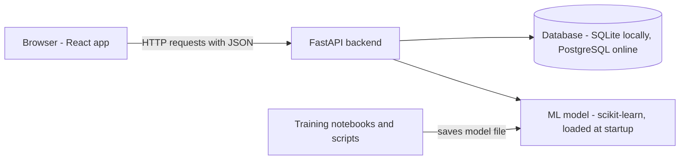
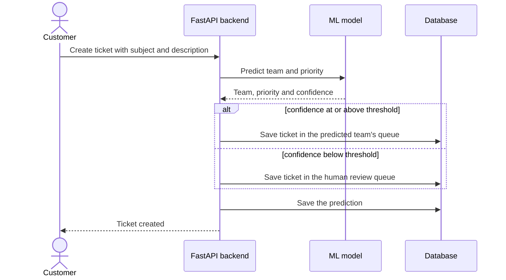

# Architecture

## 1. Overview



| Part | Job |
|---|---|
| React frontend | All screens: login, tickets, dashboards, reports |
| FastAPI backend | Business rules, login, role checks, ticket API, calls the model |
| Database | Stores users, teams, tickets, comments, predictions and corrections |
| ML model | Predicts team and priority from the ticket text |
| Training code | Cleans the dataset, trains and evaluates the model, saves it to a file |

## 2. Tech stack

| Area | Choice | Why |
|---|---|---|
| Backend | Python, FastAPI | Fast to build, automatic API docs, common in AI/ML jobs |
| Data validation | Pydantic | Checks every request and response |
| Database access | SQLAlchemy + Alembic | Standard Python database toolkit; Alembic tracks table changes |
| Database | SQLite locally, PostgreSQL online | SQLite needs no setup; PostgreSQL for the live demo |
| Login | Hashed passwords + JWT tokens | Standard way to secure an API |
| Machine learning | scikit-learn, pandas, Jupyter | TF-IDF with linear models is fast, cheap and easy to explain |
| Frontend | React | The most requested frontend skill in job posts |
| Tests | pytest | Standard Python testing tool |
| CI | GitHub Actions | Runs the tests on every push; free for public repos |
| Hosting | Render and Neon free tiers | Live demo at zero cost |

## 3. How a new ticket is routed



## 4. Planned folder structure

```text
ai-support-desk/
├── app/              FastAPI backend
│   ├── main.py       creates the app
│   ├── api/          endpoints: auth, tickets, users
│   ├── models/       database tables
│   ├── schemas/      request and response shapes
│   └── services/     business rules and ML predictions
├── ml/               notebooks, training scripts, saved model
├── frontend/         React app
├── tests/            automated tests
├── docs/             requirements and design
└── requirements.txt  Python packages
```

## 5. Main database tables (first draft)

| Table | Key fields |
|---|---|
| users | id, email, hashed_password, role (customer, agent, admin), team_id |
| teams | id, name |
| tickets | id, subject, description, status, priority, team_id, customer_id, assigned_agent_id, needs_review, created_at |
| comments | id, ticket_id, author_id, text, is_internal, created_at |
| predictions | id, ticket_id, predicted_team, predicted_priority, confidence, model_version, created_at |
| corrections | id, ticket_id, field, predicted_value, corrected_value, corrected_by, created_at |

## 6. Key decisions

| Decision | Reason |
|---|---|
| Backend, frontend and ML in one repository | Reviewers see the whole project in one place |
| Model trained offline, then loaded by the API | Training is slow; predictions must be fast |
| Unsure predictions go to a person | A wrong automatic route costs more than a short manual review |
| Corrections are stored, not used automatically | Retraining stays controlled and reviewable |